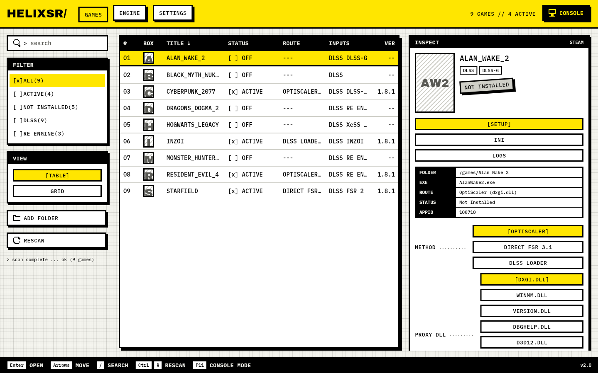
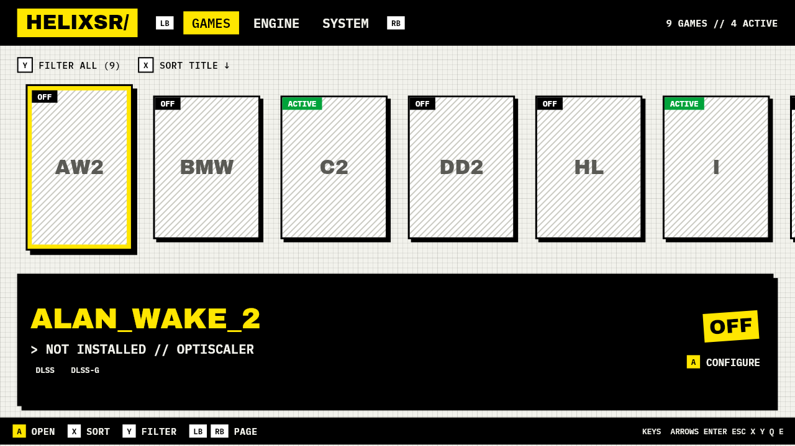
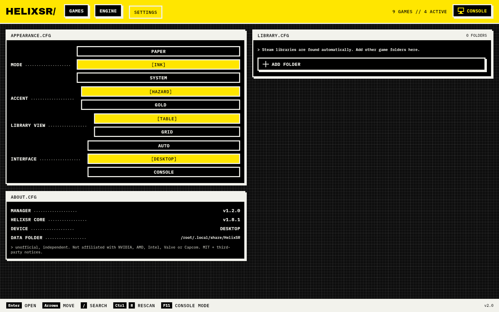
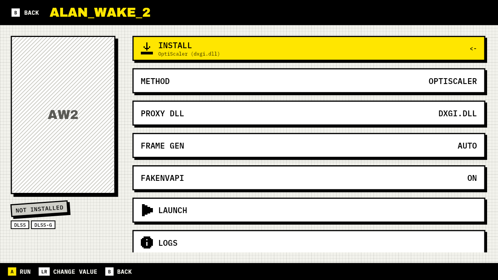
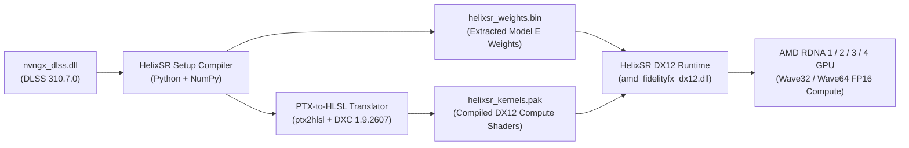

# ⚡ HelixSR Manager

[](https://github.com/Denarmo/HelixSR-Manager/releases)
[](https://github.com/lonewolf0622/HelixSR)
[](#%EF%B8%8F-installation--quick-start)
[-8B5CF6?style=for-the-badge)](#%EF%B8%8F-installation--quick-start)
[](#%EF%B8%8F-legal-disclaimers-licensing--third-party-notices)
[](https://ko-fi.com/denarmo)
[](https://discord.com)

**HelixSR Manager** is a modern, 100% standalone desktop game manager and neural network compiler GUI for Windows, Linux, and SteamOS (Steam Deck / Bazzite). Inspired by the visual workflow of **[DLSS Swapper](https://github.com/beeradmoore/dlss-swapper)**, it provides a one-click interface for compiling, deploying, configuring, and restoring **[HelixSR](https://github.com/lonewolf0622/HelixSR)** across your PC game libraries.

**What is HelixSR?**
**[HelixSR](https://github.com/lonewolf0622/HelixSR)** (created by **[lonewolf0622](https://github.com/lonewolf0622)**) is a drop-in Direct3D 12 upscaler that executes **NVIDIA's DLSS Model E neural network** using standard Direct3D 12 compute shaders on **AMD RDNA GPUs** (RDNA 1, RDNA 2, RDNA 3, and RDNA 4) — **without requiring NVIDIA Tensor Cores, an NVIDIA GPU driver, CUDA, or ROCm**. It delivers native DLSS temporal reconstruction behavior (Halton `8 × scale²` camera jitter, native DLSS quality ratios from *Ultra Performance* to *DLAA*, dynamic resolution scaling, and zero forced sharpening) on hardware gamers already own.

<p align="center">
  
</p>

> [!IMPORTANT]
> **Unofficial & Independent Project — No Proprietary NVIDIA Weights Included:**
> **HelixSR Manager** and **HelixSR** are independent, unofficial community projects and are **not affiliated with, endorsed by, or sponsored by NVIDIA Corporation, Advanced Micro Devices, Inc. (AMD), Intel Corporation, Valve Corporation, Capcom Co., Ltd., or the OptiScaler / REFramework projects**.
> Neither this repository nor its release packages contain any NVIDIA proprietary source code, `nvngx_dlss.dll` binaries, neural network weights (`helixsr_weights.bin`), or compiled NVIDIA-derived kernel packages (`helixsr_kernels.pak`). Those files are compiled strictly locally on your own computer and must **never** be shared or redistributed. See [Legal Disclaimers, Licensing & Third-Party Notices](#%EF%B8%8F-legal-disclaimers-licensing--third-party-notices) for full details.

---

## 📑 Table of Contents

1. [📸 Screenshots & UI Tour](#-screenshots--ui-tour)
2. [✨ Key Features](#-key-features)
3. [🎮 Handheld Mode & Full Controller Navigation](#-handheld-mode--full-controller-navigation)
4. [🧠 How It Works (Architecture & Injection Routes)](#-how-it-works-architecture--injection-routes)
5. [⬇️ Installation & Quick Start](#%EF%B8%8F-installation--quick-start)
6. [📖 Step-by-Step Usage Guide](#-step-by-step-usage-guide)
7. [🎞️ DLSS Frame Generation (`DLSS-G`) Hook & Translation](#%EF%B8%8F-dlss-frame-generation-dlss-g-hook--translation)
8. [🔄 Switching Between HelixSR & Custom FSR (`my-fsr`)](#-switching-between-helixsr--custom-fsr-my-fsr)
9. [🛠️ Building from Source](#%EF%B8%8F-building-from-source)
10. [📂 Repository Structure](#-repository-structure)
11. [🔧 Troubleshooting & FAQ](#-troubleshooting--faq)
12. [🙏 Referenced Projects, Credits & Acknowledgments](#-referenced-projects-credits--acknowledgments)
13. [⚖️ Legal Disclaimers, Licensing & Third-Party Notices](#%EF%B8%8F-legal-disclaimers-licensing--third-party-notices)
14. [☕ Support & 💬 Contact](#-support--contact)

---

## 🆕 Flutter Edition (Brutalist UI + Console Mode)

A new cross-platform Flutter app lives in [`app/`](app/README.md). It uses the Dena.emu brutalist design and ships two separate shells: a desktop UI (table/poster grid, inspector) and a full controller console UI (cover shelf, full-screen game page, d-pad folder browser, LB/RB paging, hold-A uninstall).

| Desktop | Console |
|---|---|
|  |  |

Build and run with `cd app && flutter run -d linux` (or `-d windows`). The WPF and Python editions remain. Note: the Dart engine mirrors `Engine.cs` as of this release; engine additions made elsewhere (for example Unity game support) are not ported yet.

---

## 📸 Screenshots & UI Tour

**HelixSR Manager** ships a brutalist Flutter UI with two shells: a desktop UI for mouse and keyboard, and a full-screen console UI for controllers (Steam Deck, ROG Ally, Legion Go and couch setups).

### 🖥️ Desktop Library & Inspector
A sortable table (or poster grid) of every detected game with filters, status, route, detected upscaler inputs and installed HelixSR version. Select a game to open the inspector with the setup, INI and log actions, method choice (OptiScaler, Direct FSR 3.1, DLSS Loader) and proxy DLL selection.


### ⚙️ Settings
Paper, Ink or System theme, accent colour, table or grid library view, and desktop or console interface (Auto switches on handhelds). Add extra game folders here.



### 🎮 Console Mode & Controller Navigation
Toggle with <kbd>F11</kbd> or the Console button. Cover shelf, LB/RB paging, X to sort, Y to filter, A to open.




---

## ✨ Key Features

### 🖥️ 100% Standalone Cross-Platform Editions
- **Windows Native Edition (`HelixSR-Manager.exe`)**:
  - Compiled directly with the built-in Windows .NET Framework 4.8 C# / WPF compiler (`csc.exe`).
  - **Zero external dependencies**: No Node.js, Electron, WebView2, or background web servers required on Windows. Runs out-of-the-box on any Windows 10 or Windows 11 installation.
  - Features the signature **HelixSR Dark Gold Aurora** theme and a one-click **Clean Light** theme toggle.
- **Linux & SteamOS Edition (`HelixSR-Manager.sh`)**:
  - Runs as a **100% standalone native desktop GUI window** (`helixsr_swapper_linux.py` via Python 3 / Tkinter) with the **exact same 1:1 UI, palette, poster grid, and slide-over game drawer** as the Windows edition—no browser required!
  - Automatically detects native Linux Steam paths, Flatpak Steam (`com.valvesoftware.Steam`), and SteamOS microSD / external drives (`/run/media/...`).
  - Automatically generates the exact Steam Proton launch option (`WINEDLLOVERRIDES="dxgi,dinput8=n,b" %command%`) required for each game's selected hooks.

### 🎮 Automatic Game Library Discovery & Visual Inspector
- **Multi-Library Steam & Custom Folder Scanner**:
  - Parses Steam's `libraryfolders.vdf` and `appmanifest_*.acf` manifests across all drives.
  - Supports adding non-Steam games (Epic Games, GOG, Xbox/standalone) via folder picker or by **dragging and dropping** any game folder or `.exe` directly onto the window.
- **Offline-First High-Resolution Cover & Hero Artwork**:
  - Loads vertical `600x900` box art and widescreen hero banners directly from your local Steam `appcache/librarycache`, with automatic multi-CDN fallback and local disk caching (`%LOCALAPPDATA%\HelixSR\cache\covers`).
- **Smart Upscaler & Engine Telemetry**:
  - Recursively inspects game directories (up to 6 levels deep) to identify the primary shipping executable, supported upscaler & Frame Generation inputs (`DLSS`, `DLSS-G`, `XeSS`, `FSR 2`, `FSR 3.1`), and **Capcom RE Engine** titles.
  - Quick filter pills (`All Games`, `⚡ HelixSR Active`, `○ Not Installed`, `🎯 Direct FSR 3.1`, `🔌 OptiScaler Hook`, `🧬 Capcom RE Engine`), instant search (<kbd>Ctrl</kbd>+<kbd>K</kbd>), sorting, and Grid/List view modes.

### ⚡ Built-in Neural Network & Shader Compiler Wizard
- **One-Click Local Compilation**:
  - Monitors the compiled network: since HelixSR 1.8 the weights and kernels are embedded in `amd_fidelityfx_dx12.dll` (one-file DLL); separate `helixsr_weights.bin` / `helixsr_kernels.pak` files from older cores are still recognized.
  - Automatically scans your installed games for existing copies of `nvngx_dlss.dll` (DLSS `310.7.0` / `310.2`) so you can compile offline, or downloads the official DLL from NVIDIA's GitHub repository on demand.
  - Automatically downloads portable Python 3.14 + NumPy and Microsoft DirectX Shader Compiler (`dxc.exe` v1.9.2607) into `%LOCALAPPDATA%\HelixSR` (verified via pinned SHA-256 hashes, requiring no administrator privileges or system-wide `PATH` changes).
  - Always compiles both **Wave32 and Wave64** shader sets (since HelixSR 1.8.0); HelixSR picks the right one for your GPU (RDNA 1-4) at runtime.
  - **Auto-Sync**: After every rebuild, automatically refreshes the HelixSR DLL (with the new network inside) in all currently installed games.

### 🔌 Advanced Hook, Frame Generation & Compatibility Controls
- **Per-Game Route & Proxy Selection**:
  - Switch freely between **Direct FSR 3.1 Replacement** and **OptiScaler Proxy Injection** (`dxgi.dll`, `winmm.dll`, `version.dll`, `dbghelp.dll`, `d3d12.dll`, `wininet.dll`, `winhttp.dll`, or `OptiScaler.asi`).
  - 🧪 **Experimental:** HelixSR 1.8.1's **DLSS Loader** route for DLSS games (no OptiScaler) - opt-in only, single-player games only.
- **DLSS Frame Generation (`DLSS-G`) Hook & Translation**:
  - Unlock the in-game **NVIDIA DLSS Frame Generation** toggle on AMD and Intel GPUs via `fakenvapi.dll` + OptiScaler (`FGInput = dlssg`) and translate it to **Intel XeSS Frame Generation (`XeFG`)**, **AMD FidelityFX Frame Generation (`FSR-FG`)**, **Nukem's `dlssg-to-fsr3`**, or **Universal `OptiFG`** — while simultaneously running **HelixSR (DLSS Model E)** for Super Resolution!
- **FakeNVAPI Integration (`fakenvapi.dll`)**:
  - Optional per-game checkbox to deploy `fakenvapi.dll` and `fakenvapi.ini`, spoofing NVAPI & Reflex presence so games unlock native **NVIDIA DLSS** and **DLSS Frame Generation** options inside their graphics menu on AMD and Intel GPUs.
- **Capcom RE Engine & REFramework Nightly Automation**:
  - Automatically detects Capcom RE Engine titles (*Dragon's Dogma 2*, *Monster Hunter Wilds*, *Monster Hunter Rise*, *Resident Evil 2 / 3 / 4 / 7 / Village*, *Pragmata*, *Street Fighter 6*, *Devil May Cry 5*, *Kunitsu-Gami*, *Dead Rising Deluxe Remaster*, etc.).
  - Optional one-click download and deployment of **[REFramework Nightly](https://github.com/praydog/REFramework-nightly)** (`dinput8.dll`), `_storage_` directory mirroring, and automatic `config.ini` sanitization (resetting stale `[Render/Adapter]` GPU locks and incompatible Reflex flags).
- **inZOI Game Profile (Unreal Engine 5)**:
  - Automatically detects *inZOI* (Steam AppId `2456740`, `BlueClient` project folder or `inZOI-Win64-Shipping.exe`) and tags it with an `inZOI` badge.
  - On install, selects the in-game upscaler that feeds HelixSR in `BlueClient\Saved\Config\Windows\GameUserSettings.ini` (`%LOCALAPPDATA%` on Windows, the game's Proton `compatdata` prefix on Linux / SteamOS): **DLSS** (`DLSSValue` Quality, `FSR3Value=0`, `FSR3FI=False`) for the OptiScaler and DLSS Loader routes, **FSR 3** for Direct FSR 3.1. `DLSSG` is only enabled when a DLSS-G translation mode is picked.
  - Adds OptiScaler's Unreal Engine on AMD fixes to `OptiScaler.ini` (`ColorResourceBarrier = 4`, `MotionVectorResourceBarrier = 8`, `AutoExposure = true`).
  - The game's original values are kept in `GameUserSettings.helixsr-backup.json` and put back on uninstall. Launch the game once before installing so `GameUserSettings.ini` exists.
- **Unity Game Detection**:
  - Detects Unity games (`UnityPlayer.dll` / `<game>_Data`), reads the engine version, scripting backend (Mono / IL2CPP), render pipeline (Built-in / URP / HDRP) and whether the build ships the D3D12 player, and tags them with a `Unity` badge and a `Unity` filter pill. This is the first step of Unity support for games without DLSS or FSR; see [docs/unity-support.md](docs/unity-support.md) for the plan.
- **Shader Cache Purger, Live INI Editor, Log Viewer & Atomic Backups**:
  - One-click **Clear Shader Cache** button purges corrupted DX12 pipeline caches (`shader.cache2`, `piplinelist.bin`, `*shader*.bin`, and Linux Proton `DXVK_state_cache` / `fozpipelinesv6`).
  - Built-in **`OptiScaler.ini` editor** and live **`helixsr.log` / `OptiScaler.log` diagnostic viewer** inside the slide-out Game Drawer.
  - Every modified or replaced file is tracked in `helixsr-install.json` and backed up in `HelixSR/backup/` or as `*.original.dll` for 100% clean restoration.

---

## 🎮 Handheld Mode & Full Controller Navigation

HelixSR Manager v1.1.0+ includes a dedicated **Fullscreen Handheld Mode** engineered specifically for PC gaming handhelds such as the **Steam Deck**, **ASUS ROG Ally**, **Lenovo Legion Go**, **MSI Claw**, **AYANEO**, **GPD Win**, and **OneXPlayer**, as well as couch-gaming setups.


### 🤖 Automatic Handheld Environment Detection
HelixSR Manager continuously inspects system telemetry upon startup and will **automatically switch into Handheld Mode** without any manual configuration when either of the following conditions is detected:

1. **Windows Xbox Mode (formerly Full Screen Experience)**:
   - Detects active Windows Handheld Gaming Configuration registry entries (`EnterGamingPostureOnStartup`, `GamingPosture`, `XboxMode`, or `GamingHomeApp`).
   - Detects the OEM Handheld Device Form factor (`HKLM\SOFTWARE\Microsoft\Windows NT\CurrentVersion\OEM\DeviceForm = 46`).
   - Detects running Xbox Handheld posture sessions (`XboxPcAppFT.exe` or `GameBarFT.exe` compact mode).
   - Detects known handheld PC chassis and motherboard models via WMI query (`ROG Ally`, `Legion Go`, `Claw`, `AYANEO`, `GPD Win`, `OneXPlayer`, `AOKZOE`).
2. **SteamOS & Bazzite (Linux / Steam Deck / Gamescope)**:
   - Detects SteamOS and Bazzite distribution identifiers (`/etc/os-release`, `ID=steamos`, `ID=bazzite`, `VARIANT_ID=steamdeck`).
   - Detects Steam Deck DMI product hardware names (`jupiter` / `galileo`).
   - Detects active Steam Deck sessions (`STEAM_DECK=1`, `SteamGamepadUI=1`, or `XDG_CURRENT_DESKTOP=gamescope`).

> [!TIP]
> **Manual Handheld Toggle:** You can switch between standard desktop window mode and fullscreen handheld mode at any time by pressing **<kbd>F11</kbd>**, clicking the **🎮 Handheld** button in the top action bar, or pressing the **View / Back** button on your controller.

### 🕹️ Full Gamepad Controller Navigation
Both the Windows Native Edition (via zero-dependency native Windows `XInput`) and the Linux/SteamOS Edition (via the HTML5 Gamepad API) feature complete controller navigation out of the box:

| Gamepad Button | Action | Context |
| :---: | :--- | :--- |
| **<kbd>A</kbd>** | **Select / Install** | In Library: opens the game drawer.<br>In Drawer: triggers Quick Install / Update. |
| **<kbd>B</kbd>** | **Back / Close** | In Drawer: closes the drawer.<br>In Search: clears and unfocuses search input. |
| **<kbd>X</kbd>** | **Focus Search** | Immediately jumps to and selects the title search bar. |
| **<kbd>Y</kbd>** | **Toggle View Mode** | Switches between Poster Grid View and Detailed List View. |
| **<kbd>LB</kbd> / <kbd>RB</kbd>** | **Cycle Tabs** | Cycles between Games Library, Engine Compiler, Custom FSR, Settings, and About. |
| **<kbd>LT</kbd> / <kbd>RT</kbd>** | **Cycle Filters** | Cycles through quick filter pills (*All*, *Active*, *Not Installed*, *OptiScaler*, *Direct FSR*, *Capcom*). |
| **<kbd>View</kbd> (Back)** | **Toggle Handheld** | Toggles between Fullscreen Handheld Mode and Standard Window Mode. |
| **<kbd>Menu</kbd> (Start)** | **Rescan Library** | Rescans all installed Steam and custom game directories (equivalent to <kbd>F5</kbd>). |
| **D-Pad / Left Stick** | **Navigate Grid / Cards** | Directionally moves focus across game cards with automatic viewport scrolling, 3px high-contrast gold highlight border, and ambient glow. |

---

## 🧠 How It Works (Architecture & Injection Routes)

### 1. Local Neural Network Translation & Execution
Rather than training a custom approximation model, **HelixSR** executes NVIDIA's actual **DLSS Model E** neural network weights and kernel logic on AMD RDNA architectures:



1. **Weight Extraction & PTX Translation**: During the one-time setup step in the **Compiler** tab, `helixsr_setup.py` extracts the Model E weights into `helixsr_weights.bin` and translates the neural network's GPU kernels into HLSL compute shaders, compiling them via Microsoft's DirectX Shader Compiler (`dxc`) into `helixsr_kernels.pak`. Since HelixSR 1.8.0 the setup then appends both to `amd_fidelityfx_dx12.dll`, so the built DLL is a single self-contained file. If `nvngx_dlss.dll` was downloaded for the build, the original NVIDIA DLL is deleted immediately after compilation.
2. **Runtime Execution**: At runtime, HelixSR exposes the standard AMD FidelityFX Super Resolution 3.1 Direct3D 12 API (`amd_fidelityfx_dx12.dll` / `amd_fidelityfx_upscaler_dx12.dll`), allowing it to act either as a direct drop-in replacement for FSR 3.1 or as the FFX backend inside OptiScaler.
3. **DLSS-Authentic Rendering**:
   - Reports DLSS's exact internal render resolutions per quality mode (from *Ultra Performance* up to native *DLAA*) and dynamic resolution ranges.
   - Requests DLSS's Halton `8 × scale²` sub-pixel camera jitter sequence.
   - Ignores FSR sharpening requests and FSR reactive masks (since DLSS Model E handles temporal stability and reconstruction natively without sharpening).
   - In *Ultra Performance* mode, the network outputs at `2×` the internal render resolution and a final lightweight pass scales to display resolution, reducing shimmer and improving speed by ~30%.

---

### 2. Game Injection Routes

When you click **Install HelixSR** on a game, HelixSR Manager automatically selects (or lets you override) one of the injection routes based on the upscaler DLLs found in the game folder:

| Route | Target Games | What HelixSR Manager Deploys | What to Select In-Game |
| :--- | :--- | :--- | :--- |
| **Route A: OptiScaler Proxy** | Games with **DLSS**, **DLSS-G**, **XeSS**, or **FSR 2** (`nvngx_dlss.dll`, `nvngx_dlssg.dll`, `libxess.dll`, `ffx_fsr2_api_*.dll`) | • Copies `OptiScaler.dll` next to the game's `.exe` as your chosen proxy hook (default `dxgi.dll`).<br>• Deploys `fakenvapi.dll` + `fakenvapi.ini` (if enabled) to unlock DLSS & DLSS-G on AMD/Intel GPUs.<br>• Creates `<ExeFolder>\HelixSR\` containing `helixsr.dll`, `helixsr_upscaler.dll` (network embedded), fallback `amd_fidelityfx_upscaler_dx12.amd.dll`, the bundled `amd_fidelityfx_framegeneration_dx12.dll`, and `my-fsr\`.<br>• Configures `OptiScaler.ini` (`Dx12Upscaler = fsr31`, `FfxDx12Path`, `FfxDx12SRPath`, plus decoupled `FfxDx12FGPath`, `XeFGPath`, `XeLLPath`, and `[FrameGen]` settings).<br>• Backs up any pre-existing proxy DLL or `OptiScaler.ini` in `<ExeFolder>\HelixSR\backup\`. | **NVIDIA DLSS**<br>*(or XeSS / FSR 2 if DLSS is hidden)* |
| **Route B: Direct FSR 3.1** | Games with native **AMD FSR 3.1** (`amd_fidelityfx_upscaler_dx12.dll` or `amd_fidelityfx_dx12.dll`) | • Renames the game's original FidelityFX DX12 DLL to `*.original.dll`.<br>• Places HelixSR's `amd_fidelityfx_dx12.dll` in its place (network embedded) alongside `helixsr-install.json`.<br>• Runs directly with zero proxy wrapper overhead. | **AMD FSR 3 / FSR 3.1** |
| **Route C: DLSS Loader** 🧪 *Experimental* | Games with **DLSS** (`nvngx_dlss.dll`) - opt-in only, never the default | • Copies HelixSR's DLSS loader as `dxgi.dll` and HelixSR (one-file DLL) as `nvngx.dll` next to the game's `.exe`.<br>• Backs up a pre-existing `dxgi.dll` / `nvngx.dll` in `<ExeFolder>\HelixSR\backup\`.<br>• No OptiScaler. Tested upstream in very few games; **never use it in online games or games with anti-cheat (ban risk)**. | **NVIDIA DLSS** |

---

## ⬇️ Installation & Quick Start

### System Requirements
- **GPU**: AMD Radeon **RDNA 1 or newer** (`RX 5000`, `RX 6000`, `RX 7000`, `RX 9000` series, Steam Deck / Z1 / Z2 APUs, AMD BC-250 `gfx1013`).
  - *Note: Older GCN / Radeon Vega GPUs (Vega 56/64, Radeon VII, Ryzen Vega APUs) are not supported because they lack `wave32` support.*
- **Graphics API**: Direct3D 12 games only (Windows native D3D12 or Linux/SteamOS via Proton / VKD3D-Proton).
- **OS**:
  - **Windows**: Windows 10 or Windows 11 (64-bit).
  - **Linux / SteamOS**: Any modern 64-bit Linux distribution with `python3` and Steam / Proton installed.

### Option 1: Download Prebuilt Release (Recommended)
1. Go to the **[Releases](https://github.com/Denarmo/HelixSR-Manager/releases)** page.
2. Download the archive for your operating system:
   - **Windows**: `helixsr-manager-windows.zip`
   - **Linux / SteamOS**: `helixsr-manager-linux.zip`
3. Extract the `.zip` archive to a permanent folder (for example `C:\Tools\HelixSR-Manager` on Windows or `~/HelixSR-Manager` on Linux/Steam Deck).
4. Launch the application:
   - **Windows**: Double-click **`HelixSR-Manager.exe`**.
   - **Linux / SteamOS**: Run **`./HelixSR-Manager.sh`** in a terminal, or double-click **`HelixSR-Manager.desktop`**.

---

## 📖 Step-by-Step Usage Guide

### Step 1: Compile the Neural Network Weights & Kernels (First-Time Setup)
Because NVIDIA's DLSS weights cannot be redistributed, you must compile them once on your PC before installing HelixSR into any game:

1. Open **HelixSR Manager** and click the **⚡ Compiler** (*Engine & Weights*) tab in the left sidebar.
2. Under **Network Compiler Wizard**, choose your DLSS source:
   - **Use from an installed game**: If HelixSR Manager detected a compatible `nvngx_dlss.dll` in one of your installed games, select it from the dropdown for instant offline compilation.
   - **Download automatically from NVIDIA GitHub**: Downloads the official DLSS `310.7.0` DLL from [NVIDIA/DLSS](https://github.com/NVIDIA/DLSS), verifies its SHA-256 checksum, extracts the network, and automatically deletes the NVIDIA DLL when finished.
3. Nothing to choose for your GPU: since HelixSR 1.8.0 both **Wave32 and Wave64** shaders are always built into the DLL.
4. Click **⚡ Compile HelixSR Network & Auto-Sync**.
5. Wait ~45–90 seconds while the live terminal logs progress. Once complete, the sidebar status indicator will turn green (**`Ready • Weights Built`**).

---

### Step 2: Select a Game & Install HelixSR
1. Switch to the **🎮 Games Library** tab.
2. Your installed Steam games (with supported upscalers) are displayed automatically.
   - *Missing a non-Steam game?* Click **＋ Add Game** in the top bar or **drag and drop** the game's folder or `.exe` onto the HelixSR Manager window.
3. Click any game card to slide open the **Game Inspector Drawer** on the right.
4. Review or customize the **Installation Method & Hooks**:
   - **OptiScaler Proxy (`dxgi.dll`, `winmm.dll`, `version.dll`, etc.)**: Default and recommended hook for maximum compatibility with DLSS, XeSS, and FSR 2. If a game conflicts with `dxgi.dll`, simply select `winmm.dll` or `version.dll` from the dropdown.
   - **Direct FSR 3.1 Replacement**: Selectable for games with native FSR 3.1 DLLs (and Capcom RE Engine titles).
   - **Frame Generation (`DLSS-G Hook / OptiFG`)**: Choose whether to keep the game's default Frame Generation or hook in-game **DLSS Frame Generation** (`XeFG`, `FSR-FG`, `Nukem's dlssg-to-fsr3`, or `Universal OptiFG`).
   - **Deploy FakeNVAPI (`fakenvapi.dll`)**: Leave checked on AMD/Intel GPUs when using OptiScaler so the game allows selecting NVIDIA DLSS & DLSS Frame Generation in its menus.
   - **Install REFramework Nightly (`dinput8.dll`)**: Automatically checked for detected Capcom RE Engine games to prevent startup or hook crashes.
5. Click **⚡ Install HelixSR**.

---

### Step 3: Configure In-Game Graphics Settings
1. Launch the game (you can click **▶ Launch Game** directly inside the drawer).
2. *(Linux / SteamOS Users Only)*: If you installed via the **OptiScaler** route or enabled **REFramework**, copy the generated **Steam Proton Launch Option** shown in the drawer into the game's *Steam Properties → General → Launch Options*:
   ```sh
   WINEDLLOVERRIDES="dxgi,dinput8=n,b" %command%
   ```
3. Open the game's **Graphics / Display Settings**:
   - If installed via **OptiScaler Route**: Enable **NVIDIA DLSS** (or **Intel XeSS** / **AMD FSR 2** if DLSS is not offered) and pick your desired quality mode (*Quality*, *Balanced*, *Performance*, *Ultra Performance*, or *DLAA*). If you selected a **DLSS-G** Frame Generation mode, also enable **DLSS Frame Generation** in the game's settings.
   - If installed via **Direct FSR 3.1 Route**: Enable **AMD FSR 3 / FSR 3.1** and pick your desired quality mode.

---

### Step 4: Manage, Tweak, or Uninstall
- **Edit `OptiScaler.ini`**: In the Game Drawer, select the **⚙️ OptiScaler.ini** tab, edit any parameter, and click **💾 Save INI Changes**.
- **Inspect Runtime Logs**: Select the **📋 Logs** tab to view live output from `helixsr.log` and `OptiScaler.log`, or click **📋 Copy** to copy diagnostics to your clipboard.
- **Clear Corrupted Shader Caches**: If a game crashes after switching upscalers or updating GPU drivers, click the **🧹 Cache** button in the drawer to purge stale `shader.cache2` / DX12 pipeline caches.
- **Restore Original Game Files**: Click **↩ Restore** in the Game Drawer (or right-click any game card → *Restore Original Files*) to remove HelixSR and put every backed-up original file back in place.

### ⌨️ Keyboard Shortcuts
| Shortcut | Action |
| :--- | :--- |
| <kbd>Ctrl</kbd> + <kbd>K</kbd> or <kbd>Ctrl</kbd> + <kbd>F</kbd> | Focus the game library search bar |
| <kbd>F5</kbd> | Rescan all Steam libraries and custom game folders |
| <kbd>Esc</kbd> | Close the open Game Inspector Drawer or clear the search query |
| <kbd>Insert</kbd> *(In-Game)* | Open the **OptiScaler** overlay menu (for games using the OptiScaler route) |

---

## 🎞️ DLSS Frame Generation (`DLSS-G`) Hook & Translation

Games that ship with **NVIDIA DLSS Frame Generation** (`nvngx_dlssg.dll` / `sl.dlss_g.dll`) are automatically tagged with an amber **`DLSS-G`** badge in your library.

While `nvngx_dlssg.dll` itself relies on proprietary NVIDIA Optical Flow Accelerator (OFA) driver callbacks, **HelixSR Manager** lets you unlock the game's native **DLSS Frame Generation** toggle on AMD GPUs (via `fakenvapi.dll` + OptiScaler's `FGInput = dlssg` hook) and route those HUD-less color, depth, and motion vector buffers to any DX12 Frame Generation backend — **all while HelixSR runs NVIDIA's DLSS Model E neural network for Super Resolution**:

| Frame Generation Mode | INI Configuration | How It Works & Required DLLs in `my-fsr` (or Game Folder) |
| :--- | :--- | :--- |
| **Game Default / Pass-Through** | `Enabled = auto`<br>`FGInput = auto`<br>`FGOutput = nofg` | Leaves Frame Generation untouched so you can use the game's built-in FSR 3 Frame Generation or play without FG. |
| **DLSS-G Hook → Intel XeFG** *(AI Neural FG on AMD)* | `Enabled = true`<br>`FGInput = dlssg`<br>`FGOutput = xefg` | Hooks in-game **DLSS Frame Generation** and executes **Intel XeSS Frame Generation (`libxess_fg.dll`)** + **XeLL Low Latency (`libxell.dll`)**, which runs AI neural optical flow and frame interpolation via standard DX12 Shader Model 6.6 on AMD RDNA GPUs. |
| **DLSS-G Hook → AMD FidelityFX FG** | `Enabled = true`<br>`FGInput = dlssg`<br>`FGOutput = fsrfg` | Hooks in-game **DLSS Frame Generation** and routes it to `amd_fidelityfx_framegeneration_dx12.dll` (decoupled via `FfxDx12FGPath` so HelixSR handles Super Resolution while FidelityFX handles Frame Generation). |
| **DLSS-G Hook → Nukem's `dlssg-to-fsr3`** | `Enabled = true`<br>`FGInput = dlssg`<br>`FGOutput = nukems` | Uses **[Nukem9's `dlssg_to_fsr3_amd_is_better.dll`](https://github.com/Nukem9/dlssg-to-fsr3)** to translate Streamline `sl.dlss_g` swapchains cleanly into FSR 3.1 Frame Generation. |
| **Universal OptiFG (`Upscaler + HUDFix`)** | `Enabled = true`<br>`FGInput = upscaler`<br>`FGOutput = fsrfg`<br>`HUDFix = true` | Adds Frame Generation to **any** DLSS/XeSS/FSR2 game (even games without native DLSS-G) by reusing upscaler motion vectors & depth and applying OptiScaler's automatic `HUDFix`. |

> [!TIP]
> **Where to place optional Frame Generation DLLs:**
> Click **📦 Custom FSR (`my-fsr`)** → **📂 Open Core my-fsr Folder** (`helixsr_core/HelixSR-1.8.1/my-fsr/`) and drop in `libxess_fg.dll`, `libxell.dll`, `amd_fidelityfx_framegeneration_dx12.dll`, or `dlssg_to_fsr3_amd_is_better.dll`. HelixSR Manager automatically detects and deploys them to your games and wires `FfxDx12FGPath`, `XeFGPath`, and `XeLLPath` in `OptiScaler.ini`!

---

## 🔄 Switching Between HelixSR & Custom FSR (`my-fsr`)

For games installed via the **OptiScaler Route**, you can compare **HelixSR** side-by-side in real time with AMD's official FSR 3.1.5 or a custom FSR 4 DLL (`amd_fidelityfx_upscaler_dx12.dll`):

1. **For a Single Game**:
   - Open the game in HelixSR Manager and click the **📦 my-fsr** button in the Game Drawer (which opens `<GameFolder>\HelixSR\my-fsr\`).
   - Drop your custom FidelityFX DLL (e.g., FSR 4.1.1) into that folder and start the game.
2. **For All Games**:
   - Go to the **📦 Custom FSR (`my-fsr`)** tab in HelixSR Manager and click **📂 Open Core my-fsr Folder** (`helixsr_core/HelixSR-1.8.1/my-fsr/`).
   - Drop your custom DLL there and click **Update / Reinstall** on your games.
3. **Switching In-Game**:
   - Press <kbd>Insert</kbd> in-game to open OptiScaler's HUD.
   - Navigate to **Upscaling** → **Upscalers** → **FFX Upscaler**.
   - Switch instantly between **`FSR HelixSR (3.1.5)`** (the default), **`FSR 3.1.5`**, or your custom **`FSR 4.x.x`** DLL!

---

## 🛠️ Building from Source

HelixSR Manager requires **no external SDKs, NuGet packages, or Visual Studio installation** to build on Windows. It compiles using the standard C# compiler (`csc.exe`) pre-installed with Windows 10 and Windows 11 (`.NET Framework 4.8`).

1. Clone the repository:
   ```powershell
   git clone https://github.com/Denarmo/HelixSR-Manager.git
   cd "HelixSR-Manager"
   ```
2. Run the build script:
   ```cmd
   build-exe.bat
   ```
3. `build-exe.bat` will:
   - Compile `src\Models.cs`, `src\Engine.cs`, `src\MainWindow.cs`, and `src\Program.cs` with `src\app.ico` into a standalone native **`HelixSR-Manager.exe`**.
   - Execute `src\package-builds.ps1` to assemble clean Windows (`build\windows\`) and Linux/SteamOS (`build\linux\`) distributions (converting shell/Python line endings to Unix `LF` and excluding any locally compiled NVIDIA weight/kernel files).
   - Package both distributions into `build\helixsr-manager-windows.zip` and `build\helixsr-manager-linux.zip`.

---

## 📂 Repository Structure

```text
HelixSR-Manager/
├── HelixSR-Manager.exe                  # Precompiled standalone Windows WPF desktop executable
├── build-exe.bat                        # One-click Windows C# compiler & cross-platform release packager
├── README.md                            # Project documentation, usage guide & legal notices
├── LICENSE                              # MIT License (Manager GUI) & Third-Party License Summary
├── docs/
│   └── screenshots/                     # High-resolution UI & feature screenshots
├── src/
│   ├── Program.cs                       # Application entry point & working directory isolation
│   ├── Models.cs                        # Data models (GameInfo, CoreStatus, GpuInfo)
│   ├── Engine.cs                        # Steam/custom scanner, injector, backup engine & REFramework manager
│   ├── MainWindow.cs                    # Pure C# WPF UI (Dark Gold / Clean Light themes, Drawer, Compiler)
│   ├── app.ico                          # Application icon
│   ├── package-builds.ps1               # Automated packager for Windows & Linux/SteamOS .zip releases
│   └── linux/
│       ├── HelixSR-Manager.sh           # Linux / SteamOS shell launcher
│       ├── HelixSR-Manager.desktop      # Freedesktop / Steam Deck Desktop Mode shortcut
│       └── helixsr_swapper_linux.py     # Zero-dependency Python 3 standalone desktop GUI & backend
├── public/                              # Frontend web assets used by the Linux / SteamOS desktop edition
│   ├── index.html
│   ├── style.css
│   └── app.js
└── helixsr_core/
    └── HelixSR-1.8.1/                   # Unmodified HelixSR v1.8.1 core distribution
        ├── amd_fidelityfx_dx12.dll      # HelixSR Direct3D 12 compute shader runtime DLL
        ├── helixsr-setup.ps1            # Windows network & shader compiler script (Apache-2.0)
        ├── helixsr-setup.sh             # Linux / Proton network & shader compiler script (Apache-2.0)
        ├── helixsr-uninstall.*          # Upstream uninstall scripts (Apache-2.0)
        ├── setup/                       # PTX-to-HLSL translator, weight extractor & kernel headers
        ├── optiscaler/                  # Unmodified OptiScaler v0.9.4 (GPL-3.0) & fakenvapi (MIT)
        ├── amd-fsr/                     # Unmodified AMD FidelityFX Upscaler & Frame Generation v4.1.1 DLLs & license
        ├── dlss-loader/                 # HelixSR DLSS loader (dxgi.dll) for the experimental DLSS route
        ├── my-fsr/                      # Drop-in directory for user-supplied custom FSR & FG DLLs
        ├── LICENSE                      # HelixSR Freeware License
        ├── LICENSE-APACHE-2.0           # Apache License 2.0 for setup scripts
        ├── SOURCE.md                    # Upstream source code & binary provenance disclosures
        └── THIRD_PARTY_NOTICES.md       # Third-party attributions & notices
```

---

## 🔧 Troubleshooting & FAQ

- **Red border around the screen, low resolution, or shaking/jittering image in-game:**
  - This indicates that HelixSR's neural network is not running because it has not been compiled yet (or the DLL in the game is an old/uncompiled copy).
  - Open **HelixSR Manager**, go to the **⚡ Compiler** tab, click **Compile HelixSR Network & Auto-Sync**, and then click **Update / Reinstall** on the game.
- **Game crashes on startup after installing or switching upscaler hooks:**
  1. Click the **🧹 Cache** button in the Game Drawer to clear stale `shader.cache2` / DirectX 12 pipeline caches.
  2. If using **OptiScaler (`dxgi.dll`)**, try switching the hook dropdown to **`winmm.dll`** or **`version.dll`**, or switch to **Direct FSR 3.1 Replacement** if the game natively supports FSR 3.1.
  3. For **Capcom RE Engine** games (*Dragon's Dogma 2*, *Monster Hunter Wilds*, *Resident Evil*, *Pragmata*), ensure **Install REFramework Nightly (`dinput8.dll`)** is checked, or try **Direct FSR 3.1 Replacement**.
- **NVIDIA DLSS or DLSS Frame Generation option is greyed out in-game:**
  - Ensure **Deploy FakeNVAPI (`fakenvapi.dll`)** is checked in the Game Drawer and click **Update / Reinstall**. Alternatively, select **Intel XeSS** or **AMD FSR 2** in the game's graphics menu — OptiScaler routes those inputs to HelixSR as well.
- **Where are the diagnostic logs located?**
  - Open the game's drawer in HelixSR Manager and click the **📋 Logs** tab to read both `helixsr.log` and `OptiScaler.log` directly inside the app.

---

## 🙏 Referenced Projects, Credits & Acknowledgments

**HelixSR Manager** builds upon and integrates the work of several outstanding projects in the PC graphics and modding community. Full credit goes to their respective authors and contributors:

| Project | Author / Maintainer | Role in HelixSR Manager | License |
| :--- | :--- | :--- | :--- |
| **[HelixSR](https://github.com/lonewolf0622/HelixSR)** | **[lonewolf0622](https://github.com/lonewolf0622)** | Core Direct3D 12 DLSS Model E compute shader runtime (`amd_fidelityfx_dx12.dll`, v1.8.1) and PTX-to-HLSL network compiler (`setup/`). | HelixSR Freeware License & Apache-2.0 |
| **[OptiScaler](https://github.com/OptiScaler/OptiScaler)** | **OptiScaler Contributors** ([cdozdil](https://github.com/cdozdil) et al.) | Unmodified official release (`v0.9.4`) used as an upscaler and Frame Generation proxy (`FGInput = dlssg` / `OptiFG`) to route DLSS, XeSS, and FSR 2 inputs to HelixSR. | GNU GPL v3.0 |
| **[fakenvapi](https://github.com/FakeMichau/fakenvapi)** | **[FakeMichau](https://github.com/FakeMichau)** | Unmodified NVAPI & Reflex translation layer (`fakenvapi.dll`) bundled with OptiScaler to unlock DLSS and DLSS Frame Generation UI options on AMD and Intel GPUs. | MIT License |
| **[dlssg-to-fsr3](https://github.com/Nukem9/dlssg-to-fsr3)** | **[Nukem9](https://github.com/Nukem9)** | Optional user-supplied Streamline `dlssg` to FSR 3.1 Frame Generation swapchain translator (`dlssg_to_fsr3_amd_is_better.dll`) supported via `FGOutput = nukems`. | LGPL-3.0 |
| **[Intel XeSS SDK (`XeFG` / `XeLL`)](https://github.com/intel/xess)** | **Intel Corporation** | Optional user-supplied AI Frame Generation & Low Latency libraries (`libxess_fg.dll`, `libxell.dll`) supported via `FGOutput = xefg`. | Intel XeSS License |
| **[REFramework](https://github.com/praydog/REFramework)** & **[REFramework-nightly](https://github.com/praydog/REFramework-nightly)** | **[praydog](https://github.com/praydog)** | Downloaded on-demand (`dinput8.dll`) when enabled for Capcom RE Engine games to ensure hook compatibility and stability. | MIT License / Upstream Terms |
| **[DLSS Swapper](https://github.com/beeradmoore/dlss-swapper)** | **[beeradmoore](https://github.com/beeradmoore)** | Visual UI/UX inspiration for the poster library grid and slide-out game inspector drawer. | GPL-3.0 *(Inspiration only; no code used)* |
| **[AMD FidelityFX SDK / FSR](https://github.com/GPUOpen-LibrariesAndSDKs/FidelityFX-SDK)** | **Advanced Micro Devices, Inc.** | Unmodified fallback FidelityFX upscaler binary (`amd_fidelityfx_upscaler_dx12.dll` v4.1.1) and Lanczos weight approximation routines. | AMD FidelityFX License & MIT |
| **[DirectX Shader Compiler (DXC)](https://github.com/microsoft/DirectXShaderCompiler)** | **Microsoft Corporation** | Downloaded locally (`v1.9.2607`) during network compilation to compile generated HLSL shaders into DXIL. | University of Illinois / NCSA Open Source |
| **[NVIDIA DLSS SDK](https://github.com/NVIDIA/DLSS)** | **NVIDIA Corporation** | Official upstream repository from which the setup script locally fetches `nvngx_dlss.dll` (`310.7.0`) upon user request. | NVIDIA DLSS License |
| **[Python](https://www.python.org/)** & **[NumPy](https://numpy.org/)** | **Python Software Foundation / NumPy Developers** | Embeddable runtime downloaded locally into `%LOCALAPPDATA%\HelixSR` to execute the HelixSR network builder scripts. | PSF License & BSD-3-Clause |

---

## ⚖️ Legal Disclaimers, Licensing & Third-Party Notices

> [!CAUTION]
> **Please read this section carefully before downloading, using, or redistributing any part of this project.**

### 1. Non-Affiliation & Trademarks
- **HelixSR Manager** and **HelixSR** are independent, non-commercial, unofficial community projects.
- They are **not affiliated with, endorsed by, sponsored by, authorized by, or otherwise approved by NVIDIA Corporation, Advanced Micro Devices, Inc. (AMD), Intel Corporation, Microsoft Corporation, Valve Corporation, Capcom Co., Ltd., or the developers of OptiScaler, fakenvapi, REFramework, or DLSS Swapper**.
- **NVIDIA**, **GeForce**, **DLSS**, and **CUDA** are registered trademarks and/or intellectual property of **NVIDIA Corporation**.
- **AMD**, **Radeon**, **RDNA**, **FidelityFX**, and **FSR** are registered trademarks and/or intellectual property of **Advanced Micro Devices, Inc.**
- **Intel** and **XeSS** are registered trademarks of **Intel Corporation**.
- **Microsoft**, **Windows**, and **DirectX / Direct3D** are registered trademarks of **Microsoft Corporation**.
- **Steam**, **SteamOS**, and **Steam Deck** are registered trademarks of **Valve Corporation**.
- **RE Engine** and all associated game titles are registered trademarks of **Capcom Co., Ltd.**
- All other trademarks, service marks, trade names, product names, and game cover artwork displayed automatically from the user's local Steam installation or Steam CDN are the property of their respective owners.

### 2. No Proprietary NVIDIA Software or Neural Network Weights Included
- **Neither this GitHub repository nor any of its release archives (`helixsr-manager-windows.zip`, `helixsr-manager-linux.zip`) contain NVIDIA's `nvngx_dlss.dll`, NVIDIA neural network weights (`helixsr_weights.bin`), or NVIDIA-derived compiled shaders (`helixsr_kernels.pak`).**
- During local setup, the compiler scripts (`helixsr_core/HelixSR-1.8.1/setup/`) either use a local copy of `nvngx_dlss.dll` already present on the user's computer or download `nvngx_dlss.dll` directly from NVIDIA's official GitHub repository ([github.com/NVIDIA/DLSS](https://github.com/NVIDIA/DLSS), subject to NVIDIA's own license terms) to generate `helixsr_weights.bin` and `helixsr_kernels.pak` locally on the user's machine.
- Those locally generated files (`helixsr_weights.bin` and `helixsr_kernels.pak`) remain the exclusive intellectual property of **NVIDIA Corporation**, are not covered by any license in this repository, are strictly for personal use on the computer where they were generated, and **must NEVER be shared, uploaded, hosted, or redistributed**.

### 3. Software Licenses & Redistribution Compliance
This distribution is a multi-license aggregation. Each component is governed by its own license terms:

1. **HelixSR Manager GUI & Wrapper Application (`src/`, `public/`, `build-exe.bat`, `HelixSR-Manager.exe`)**:
   - **Fork Ownership Notice:** Denarmo is not the original author or sole owner of the underlying forked codebase; copyright in pre-existing code remains with its original authors and contributors.
   - **Permission for Others to Use:** All modifications, enhancements, bug fixes, refactoring, and additions authored by Denarmo and project contributors are freely licensed under the **[MIT License](LICENSE)** and may be used, modified, and redistributed by others without restriction.
2. **HelixSR Core (`helixsr_core/HelixSR-1.8.1/amd_fidelityfx_dx12.dll` and documentation)**:
   - Copyright © 2026 **lonewolf0622**. All rights reserved.
   - Governed by the **[HelixSR Freeware License](helixsr_core/HelixSR-1.8.1/LICENSE)**.
   - Redistributed here **unmodified, complete, including all original licenses and notices, and completely free of charge** in strict compliance with Section 2 of the HelixSR Freeware License.
   - Per Section 3 of the HelixSR Freeware License, you may not modify HelixSR's compiled binaries, create derivative works of its compiled binaries, or reverse engineer, decompile, or disassemble them, nor may you sell, rent, sublicense, or host HelixSR as part of any paid product or service.
3. **HelixSR Setup & Compiler Scripts (`helixsr_core/HelixSR-1.8.1/helixsr-setup.*` and `setup/`)**:
   - Copyright © 2026 **lonewolf0622**. Licensed under the **[Apache License, Version 2.0](helixsr_core/HelixSR-1.8.1/LICENSE-APACHE-2.0)**.
4. **OptiScaler (`helixsr_core/HelixSR-1.8.1/optiscaler/OptiScaler.dll` & `OptiScaler.ini`)**:
   - Included unmodified from the official OptiScaler v0.9.4 release under the **[GNU General Public License v3.0 (GPL-3.0)](helixsr_core/HelixSR-1.8.1/optiscaler/LICENSE-GPL-3.0.txt)**.
   - Complete source code for OptiScaler v0.9.4 is available at [https://github.com/OptiScaler/OptiScaler/releases/tag/v0.9.4](https://github.com/OptiScaler/OptiScaler/releases/tag/v0.9.4) (see [SOURCE.md](helixsr_core/HelixSR-1.8.1/SOURCE.md)).
   - OptiScaler is distributed alongside HelixSR as a separate, independent program (mere aggregation under GPLv3 Section 5). Neither HelixSR nor HelixSR Manager links against or incorporates GPL-licensed source code.
5. **fakenvapi (`helixsr_core/HelixSR-1.8.1/optiscaler/fakenvapi.dll` & `fakenvapi.ini`)**:
   - Included unmodified under the **[MIT License](helixsr_core/HelixSR-1.8.1/optiscaler/fakenvapi-LICENSE.txt)**. Source code: [https://github.com/FakeMichau/fakenvapi](https://github.com/FakeMichau/fakenvapi).
6. **AMD FidelityFX Upscaler (`helixsr_core/HelixSR-1.8.1/amd-fsr/amd_fidelityfx_upscaler_dx12.dll`)**:
   - Copyright © Advanced Micro Devices, Inc. Included unmodified in binary form under the **[AMD FidelityFX License](helixsr_core/HelixSR-1.8.1/amd-fsr/FidelityFX_v2_LICENSE.md)** and MIT-licensed Lanczos weight approximation notice in **[THIRD_PARTY_NOTICES.md](helixsr_core/HelixSR-1.8.1/THIRD_PARTY_NOTICES.md)**.

### 4. Anti-Cheat & Online Multiplayer Warning
> [!WARNING]
> **DO NOT USE IN COMPETITIVE MULTIPLAYER OR ANTI-CHEAT PROTECTED GAMES.**
> HelixSR Manager installs proxy DLLs (`dxgi.dll`, `winmm.dll`, `version.dll`, `dinput8.dll`) and replaces upscaler DLLs (`amd_fidelityfx_upscaler_dx12.dll`) inside game directories. Anti-cheat systems (including but not limited to **EasyAntiCheat (EAC)**, **BattlEye**, **Riot Vanguard**, **RICOCHET**, **EA Javelin**, and **Valve Anti-Cheat (VAC)**) may treat modified or injected DLLs as unauthorized tampering.
> Use this software **exclusively in single-player or offline modes**. The authors and contributors assume **zero responsibility** for any account suspensions, bans, or penalties incurred in online games.

### 5. Disclaimer of Warranty & Limitation of Liability ("Use at Your Own Risk")
THIS SOFTWARE AND ALL INCLUDED OR REFERENCED COMPONENTS ARE PROVIDED **"AS IS"**, WITHOUT WARRANTY OF ANY KIND, EXPRESS OR IMPLIED, INCLUDING BUT NOT LIMITED TO THE WARRANTIES OF MERCHANTABILITY, FITNESS FOR A PARTICULAR PURPOSE, TITLE, AND NON-INFRINGEMENT.

IN NO EVENT SHALL THE AUTHORS, COPYRIGHT HOLDERS, OR CONTRIBUTORS BE LIABLE FOR ANY CLAIM, DAMAGES, OR OTHER LIABILITY, WHETHER IN AN ACTION OF CONTRACT, TORT, OR OTHERWISE, ARISING FROM, OUT OF, OR IN CONNECTION WITH THE SOFTWARE OR THE USE OR OTHER DEALINGS IN THE SOFTWARE, INCLUDING BUT NOT LIMITED TO GAME CRASHES, CORRUPTED SAVE DATA, OPERATING SYSTEM INSTABILITY, ACCOUNT SUSPENSIONS/BANS, OR HARDWARE DAMAGE. YOU ASSUME ALL RISK ASSOCIATED WITH MODIFYING GAME FILES ON YOUR SYSTEM.

---

## ☕ Support & 💬 Contact

- **Support on Ko-fi:** If you enjoy using HelixSR Manager and want to support ongoing development, updates, and testing across hardware, you can support me on **[Ko-fi (ko-fi.com/denarmo)](https://ko-fi.com/denarmo)**.
- **Discord:** For questions, troubleshooting assistance, or to get in touch, reach out directly on Discord: **`@denarmo`**.

